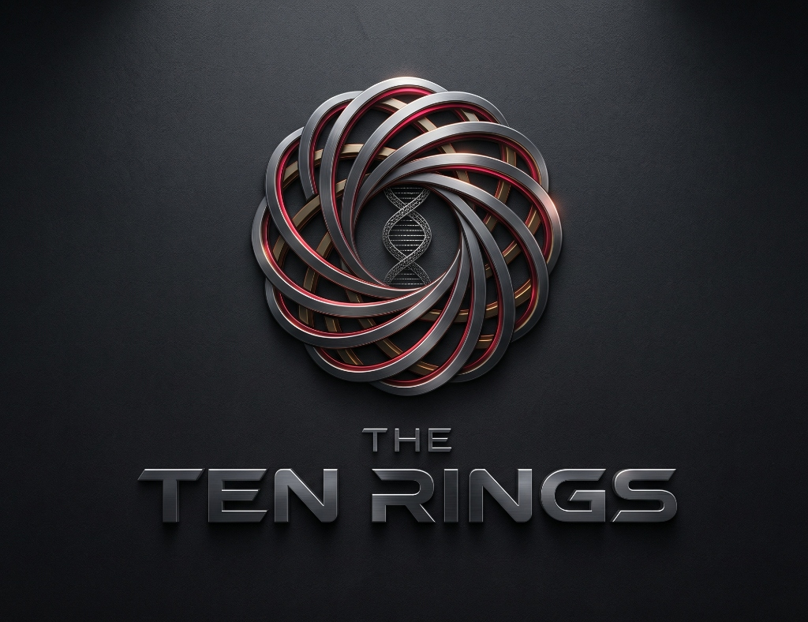

# THE TEN RINGS 🧬

> **Converging Deep Computing & Synthetic Biology for Planetary Resilience and Human Longevity.**

THE TEN RINGS is an autonomous, interdisciplinary biological computing hub and synthetic genomics enterprise engineering open-access systems, foundation bio-models, and ecological restoration infrastructure.

---

## 🏛️ The 10 Rings Matrix

| Ring | Code | Architecture Domain | Core Engine & Capability |
| :--- | :--- | :--- | :--- |
| **01** | `R-01` | **Foundation Bio-Compute** | Transformer-scale structural sequence modeling & active inference |
| **02** | `R-02` | **Planetary Biome Dynamics** | Carbon sink simulation & climate ecosystem digital twins |
| **03** | `R-03` | **Metagenomic Surveillance** | Real-time environmental sequencing & pandemic early warning |
| **04** | `R-04` | **Precision Agro-Restoration** | Soil microbiome restoration & stress-resilient crop genetics |
| **05** | `R-05` | **Cell-Free Synthesis** | In-vitro transcription/translation molecular foundries |
| **06** | `R-06` | **Molecular Biosecurity** | Dual-use sequence screening & algorithmic biodefense |
| **07** | `R-07` | **Translational Therapeutics** | AI-driven neoantigen discovery & oncology screening |
| **08** | `R-08` | **Synthetic Nanomachines** | DNA origami nanostructures & targeted molecular delivery |
| **09** | `R-09` | **Neural-Cell Interfaces** | Bio-hybrid memristive compute & biological sensor arrays |
| **10** | `R-10` | **Closed-Loop Autonomy** | Autonomous robotics & self-optimizing wet-lab pipelines |

---

## 🚀 Active Systems Pipeline

1. **PROJECT HELIX-CORE** (`R-01 · R-02`) — Foundational bio-computation engine & protein language transformers.
2. **PROJECT AEGIS** (`R-03 · R-06`) — Autonomous biodefense system performing continuous pathogen surveillance.
3. **NGS Read Quality Control Pipeline** (`R-01 · R-03`) — Production-grade automated bioinformatics pipeline processing raw sequencing reads.
4. **Comparative Genomic Analysis of *Escherichia coli*** (`R-03 · R-07`) — High-throughput pan-genomic comparative pipeline identifying antimicrobial resistance (AMR) markers.
5. **Hariyali 2.0** (`R-04 · R-02`) — AI-driven precision ecological restoration platform restoring depleted topsoils.
6. **Gutek** (`R-04 · R-05`) — Closed-loop bio-valorization pipeline transforming agricultural biomass into bio-inputs.

---

## 🔭 Frontier R&D Horizon (Upcoming Initiatives)

- **PROJECT METAEARTH** (`2027 Beta`) — Planetary-scale computational biosphere digital twin.
- **PROJECT BIOFORGE** (`2027 Validation`) — Autonomous cell-free molecular assembly foundry.
- **PROJECT ONCOTRACE** (`2028 Phase 1`) — Ultra-sensitive circulating tumor DNA (ctDNA) liquid biopsy platform.
- **PROJECT NANOGENIX** (`2028 Simulation`) — Programmable nanoscale DNA robotic delivery chassis.

---

## 👨‍🔬 Leadership & Architect

**Punit Kant**  
- Founder & Principal Architect, *THE TEN RINGS*
- Creator of *Hariyali 2.0* & *GuTek*
- B.Tech Biotechnology · Bioinformatics & Computational Biology  
- **Contact:** [thepunitkant26@gmail.com](mailto:thepunitkant26@gmail.com) | [kantpunit.bt.work@gmail.com](mailto:kantpunit.bt.work@gmail.com)
- **GitHub:** [@kantpunit26](https://github.com/kantpunit26)

---

## 📄 License

Licensed under the Open Science Framework & MIT License.
